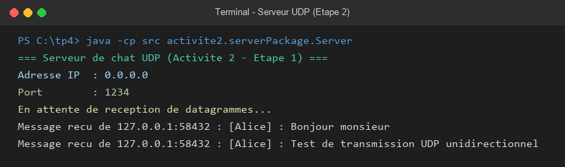
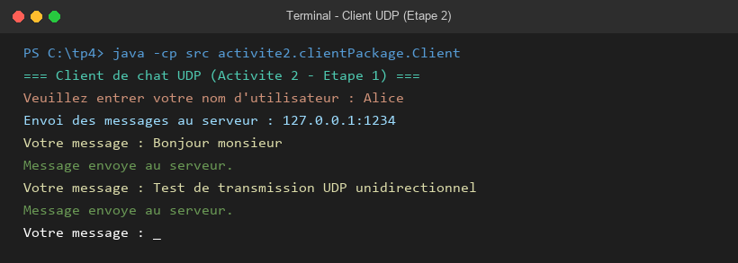
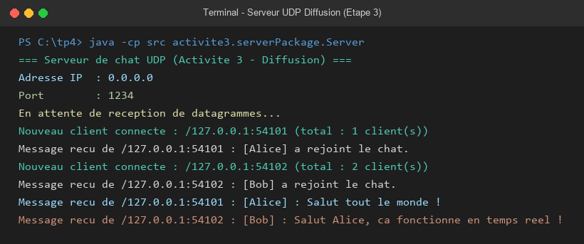
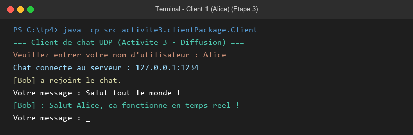
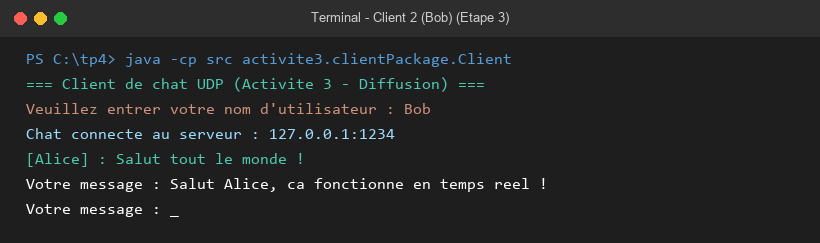
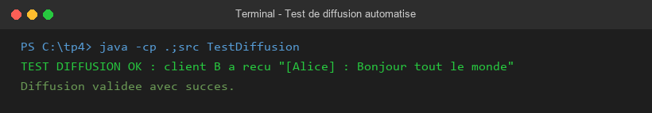

# TP 4 : Sockets en mode non-connecté UDP (Chat C/S)

**Matière :** Développement d'applications réparties — LSI 3 (FSS)  
**Enseignantes :** Amal ABID & Zeineb DAOUD  

---

## 1. Synthèse

Cette application implémente un service de chat client/serveur asynchrone en Java basé sur le protocole **UDP** (`DatagramSocket`, `DatagramPacket`) :
* **Mode non-connecté :** Aucun établissement préalable de session (pas de `connect()` ni d'`accept()`). Chaque datagramme porte les données et l'adresse IP/port du destinataire.
* **Étape 2 (Unidirectionnel) :** Le client transmet des messages au format `[NomUtilisateur] : message` vers le serveur (port `1234`), qui les affiche avec les coordonnées de l'expéditeur.
* **Étape 3 (Diffusion Multi-Clients) :** 
  * Le serveur maintient une liste d'adresses (`List<SocketAddress>`) pour simuler la connexion et diffuse chaque message reçu à tous les autres clients enregistrés (exclusion de l'émetteur).
  * Les clients utilisent deux threads simultanés : un pour la saisie clavier (envoi) et un thread d'arrière-plan pour la réception en temps réel.

---

## 2. Étape 2 : Chat Unidirectionnel

### Serveur UDP
```bash
java -cp src activite2.serverPackage.Server
```


### Client UDP
```bash
java -cp src activite2.clientPackage.Client
```


---

## 3. Étape 3 : Chat Bidirectionnel et Diffusion

### Serveur de Diffusion
```bash
java -cp src activite3.serverPackage.Server
```


### Clients en temps réel
* **Client 1 (Alice) :**
```bash
java -cp src activite3.clientPackage.Client
```


* **Client 2 (Bob) :**
```bash
java -cp src activite3.clientPackage.Client
```


---

## 4. Test automatisé de validation

```bash
java -cp ".;src" TestDiffusion
```


---

## 5. Dépôt des livrables (GitHub & ENT)

### Commandes pour publier sur GitHub :
```bash
git init
git add .
git commit -m "TP4 : Chat UDP client-serveur et diffusion multi-clients"
git branch -M main
git remote add origin https://github.com/<votre-identifiant>/votreNomPrenom_LSI3_DevAppReparties.git
git push -u origin main
```
* **Livrables à déposer sur l'ENT :**
  1. Lien du repository GitHub.
  2. Le fichier `README.md` contenant la synthèse et les captures d'écran.
